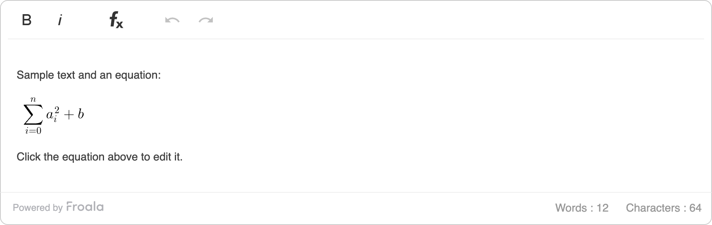
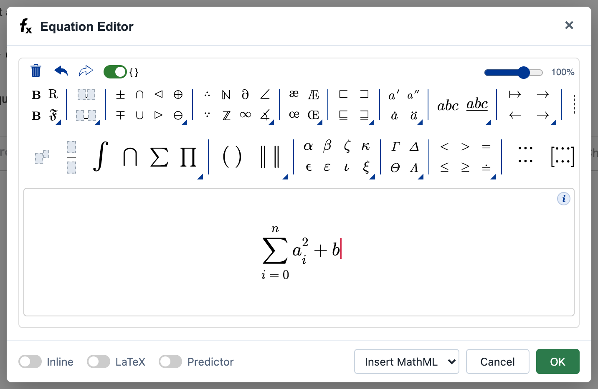

# fxEditor for Froala

`@codecogs/fxeditor-froala` adds an **fx** button to the toolbar of
[Froala Editor](https://froala.com) 3 and 4. It opens [fxEditor](https://fxeditor.codecogs.com),
CodeCogs' equation editor, in a dialog: a toolbar of symbols and structures, a maths view you
type into directly, and a LaTeX view that stays in step with it. The equation is inserted at the
cursor as MathML (the default) or as an SVG image, chosen in the dialog. Click an inserted
equation to edit it again - a single click, not a double one (see below).

It is a single script and stylesheet, `eqneditor.js` and `eqneditor.css`, with no build step.

Froala Editor itself is a commercial product (from Idera) and is not part of this package: you
need a Froala licence for Froala itself. It is a peer dependency, loaded from your own copy of
Froala.



*The fx button on Froala's toolbar.*



*fxEditor open in Froala.*

## Links

- [Documentation and live demo](https://fxplugins.codecogs.com/docs/froala.html)
- [Customise and download](https://fxplugins.codecogs.com/docs/froala.html#customise) - design
  the editor's look and download the result
- [All fxEditor plugins](https://fxplugins.codecogs.com)
- [fxEditor](https://fxeditor.codecogs.com)
- [Source on GitHub](https://github.com/willzyba/froala)

## Installing from npm

```bash
npm install @codecogs/fxeditor-froala
```

The package is being published to npm. Until it appears there, install it from git as below, or
load both files from `https://fxplugins.codecogs.com/froala/`.

Load the plugin's script and stylesheet after Froala's own:

```html
<link rel="stylesheet" href="node_modules/@codecogs/fxeditor-froala/eqneditor.css">
<script src="node_modules/@codecogs/fxeditor-froala/eqneditor.js"></script>
```

## Installing from git

```bash
git clone https://github.com/willzyba/froala.git
```

Copy `eqneditor.js` and `eqneditor.css` to your site, and load them after Froala's own files:

```html
<link rel="stylesheet" href="/path/to/eqneditor.css">
<script src="/path/to/eqneditor.js"></script>
```

Or, without copying anything, from the plugins site:

```html
<link rel="stylesheet" href="https://fxplugins.codecogs.com/froala/eqneditor.css">
<script src="https://fxplugins.codecogs.com/froala/eqneditor.js"></script>
```

## Usage

Add `eqneditor` to the toolbar and give the plugin your fxEditor licence key, alongside Froala's
own options:

```html
<script>
  new FroalaEditor('#editor', {
    toolbarButtons: ['bold', 'italic', '|', 'eqneditor'],
    eqneditorLicence: 'YOUR-FXEDITOR-LICENCE-KEY',   // from fxeditor.codecogs.com/purchase
    eqneditorDesign: { colour: '#0f7a4d' }           // optional
  });
</script>
```

The equation editor itself is fetched from `https://fxtex.codecogs.com` the first time it is needed, so
you always get the current editor. The plugin adds the MathML elements to Froala's
`htmlAllowedTags` and `htmlAllowedAttrs` itself, so nothing else needs configuring for MathML to
survive editing.

To use it: click where the equation should go, click **fx**, build the equation, choose MathML
or an image, and insert it.

MathML needs a stylesheet on the page that displays it. The plugin loads it into the editing area
for you; on the page that finally shows your content, add:

```html
<link id="fxtex-style" rel="stylesheet" href="https://fxtex.codecogs.com/fxtex.css">
```

The `id` is the one fxTeX Pro looks for: on a page that also runs the editor, fxTeX Pro sees
the rules are already there and does not add a second copy.

### Why a single click, not a double one

Froala shows its own resize and align popup over an image on the first click, so a double-click
never reaches the image. The plugin therefore opens the equation dialog on a single click instead,
in place of Froala's popup. This applies only to equations - images from CodeCogs' rendering
service, and MathML carrying its LaTeX - so an ordinary image still gets Froala's usual popup.

### Trying the example

```bash
cd froala
npm install
npm start
```

`npm install` fetches Froala into `node_modules`, which [`example.html`](example.html) loads, and
`npm start` opens the page. Before opening it, replace its two placeholders: `{{EQN_SERVER}}`
with `https://fxtex.codecogs.com` and `{{FXTEXPRO_KEY}}` with your licence key. The documentation site
fills these in when it publishes the demo.

## Licence key

Equations are rendered by fxTeX Pro, which needs a licence key for your domain. Without one,
equations show the reason they cannot render in place of the maths.

Get your licence key from [fxeditor.codecogs.com/purchase](https://fxeditor.codecogs.com/purchase).

The key goes in the `eqneditorLicence` option. This is separate from Froala's own licence key.

### Options

Passed alongside Froala's own options:

| Option | Default | Meaning |
|---|---|---|
| `eqneditorLicence` | | Your fxEditor licence key. Required. |
| `eqneditorDesign` | | The editor's look: dialog width, height and scale, toolbar panels and size, colour, equation and markup sizes, undo/redo, how the dialog opens. Build one in [Customise and download](https://fxplugins.codecogs.com/docs/froala.html#customise). |
| `eqneditorServer` | `'https://fxtex.codecogs.com'` | Where the equation editor's own code is loaded from, as a URL (a bare host is taken as https). |
| `eqneditorRenderUrl` | `'https://fxtex.codecogs.com'` | The rendering service for equations inserted as images. Point it at your own fxTeX Server to keep equations inside your network. |
| `eqneditorScriptUrl` | from `eqneditorServer` | Full URL of the equation editor bundle, when the default path does not suit. |
| `eqneditorCssUrl` | from `eqneditorServer` | Full URL of the equation editor stylesheet. |
| `eqneditorMathmlCssUrl` | from `eqneditorServer` | The MathML stylesheet (`fxtex.css`) loaded for the editing view as soon as the editor starts, under the id fxTeX Pro looks for (`fxtex-style`), so fxTeX Pro uses it rather than adding its own copy. With `iframe: true` it goes into Froala's iframe. |

## Licence

Copyright (c) 2026 CodeCogs, Zyba Ltd.

The plugin is released under the MIT licence - see
[`LICENSE`](https://github.com/willzyba/froala/blob/main/LICENSE).

Froala Editor is a commercial product, licensed separately by its publisher; see
[froala.com](https://froala.com). fxEditor and fxTeX Pro need their own licence key, as above.
